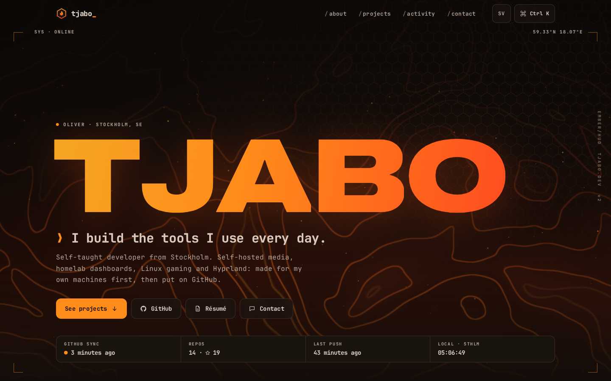
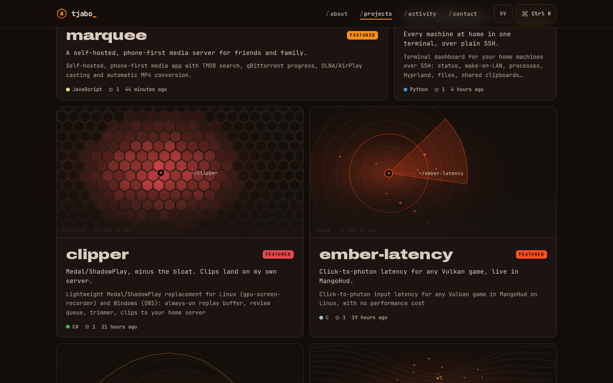
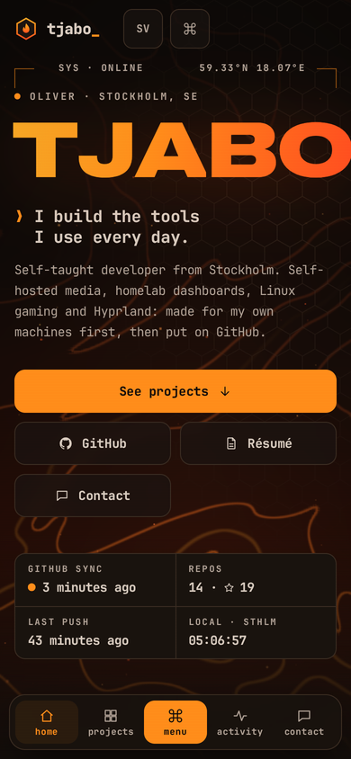

# tjabo.dev

My portfolio: a hand-written WebGL ember hero, a ⌘K command palette, a hidden terminal and a project grid that keeps itself in sync with every public repo on my GitHub. Same palette and attitude as my Hyprland rice, **ember**.

**Live:** [tjabo.dev](https://tjabo.dev) · English at `/`, Swedish at `/sv`



<p>


</p>

## Features

- **Thermal hero shader.** WebGL2, written by hand: domain-warped noise drawn as glowing isotherms with a few hundred embers rising through it. The cursor is a heat source and scrolling speeds up the updraft. It renders at a reduced internal resolution (about 0.55 MP on desktop, 0.2 MP on phones), adapts if frames run slow, pauses off-screen and in hidden tabs, and falls back to a static gradient on software renderers, tiny devices, data-saver or without WebGL2.
- **Projects straight from GitHub.** Every public, non-fork repo shows up on its own, in a bento grid with filters (language, topic) and sorting (featured, recently updated, most stars). Featured repos get big cards with the first screenshot from their README, or a generated cover seeded by the repo name.
- **A page per repo** at `/projects/<repo>`: the rendered README (GitHub-flavoured markdown, highlighted code, relative links and images rewritten to GitHub), stats, CI status of the default branch, the latest release, an install snippet (taken from the README's Install section when it has one), languages, recent commits, related projects and previous/next navigation.
- **Activity:** the public contribution calendar as an ember heatmap, a feed of recent commits and releases across all repos, and totals (repos, stars, languages counted per repo, not by bytes).
- **⌘K / Ctrl+K command palette:** jump to any project or section, switch language, copy Discord or email, open the résumé, toggle motion, open the terminal.
- **Hidden terminal:** press <kbd>`</kbd>. `help`, `ls projects`, `cat <repo>`, `open <repo>`, `neofetch`, `stats`, `lang sv`, `motion off`, tab completion and history.
- **Motion that respects you:** scroll reveals, magnetic buttons, cards that tilt and glow under the cursor, route transitions. All of it follows `prefers-reduced-motion` and the motion toggle (saved per browser).
- **Phone first:** works from 360 px wide, a bottom dock within thumb reach, no horizontal scrolling.
- **Shareable:** generated Open Graph images for every page and project, `sitemap.xml`, `robots.txt`, an RSS feed of releases (`/feed.xml`) and JSON-LD (`Person`, `SoftwareSourceCode`).
- **Contact form → Discord** through a webhook, rate limited per IP (3 per 5 minutes), with a honeypot. Visitors can never ping `@everyone`.

## Stack

Next.js 16 (App Router) and React 19, plain CSS, and three server-only libraries: `marked` + `highlight.js` for READMEs and `sanitize-html` to keep them safe. No CSS framework, no animation library, no WebGL library. Fonts (JetBrains Mono, Archivo Expanded) are self-hosted subsets. Initial JS on a modern browser is about 158 kB gzipped, ~116 kB of which is React and Next itself; the shader, palette and terminal load lazily. Lighthouse: performance 96 (mobile) / 100 (desktop); accessibility, best practices and SEO 97–100.

## How the GitHub sync works

```
GitHub GraphQL ──► lib/github.js ──► memory ──► .cache/github.json ──► pages (ISR, 1 h)
     ▲                 ▲
     │                 └── POST /api/github (webhook, HMAC-checked) → refetch + revalidate every page
     └── github.com/users/<owner>/contributions (public calendar)
```

1. **On the server only.** `lib/github.js` asks the GraphQL API for the owner's repositories with `privacy: PUBLIC, isFork: false`, then filters again by each repo's own `isPrivate` / `isFork` flags (a repo with unknown flags is dropped) and the `hidden` list. Nothing is fetched from the browser, and private repo names or counts never reach a page.
2. **Per repo:** description, topics, primary and all languages, stars, forks, last push, latest releases, CI status of the default branch (`statusCheckRollup`), homepage, license, recent commits and the README, all in one query.
3. **The heatmap** comes from GitHub's public contributions page, so it shows exactly what anyone sees on the profile, never private work.
4. **Caching:** results live in memory and in `CACHE_DIR/github.json` for 30 minutes (`GITHUB_CACHE_TTL_MINUTES`). If GitHub is down, rate-limited or the token is bad, pages keep the last good data from disk; a failure backs off for two minutes instead of retrying on every request.
5. **Freshness:** pages are regenerated at most hourly (ISR), and a GitHub webhook makes it instant: a push, release or repo change refetches and drops every cached page within seconds. A new public repo appears on the next hourly refresh even without a webhook.
6. **No token?** It still works through the unauthenticated REST API, minus CI status, release lists and the per-language split.

### Webhook

The endpoint is `POST https://tjabo.dev/api/github`. It checks `X-Hub-Signature-256` (HMAC-SHA256 of the raw body with `GITHUB_WEBHOOK_SECRET`) and answers `401` to anything unsigned.

Add it to every public repo at once (re-run after creating new repos; it updates existing hooks instead of duplicating them):

```sh
GITHUB_WEBHOOK_SECRET=<same value as on the server> scripts/github-webhooks.sh
```

Or by hand, per repo: **Settings → Webhooks → Add webhook**, payload URL `https://tjabo.dev/api/github`, content type `application/json`, the secret, and the events *Pushes*, *Releases*, *Repositories*, *Stars*, *Workflow runs*. GitHub sends a `ping` first; the site answers `{"ok":true,"pong":true}`.

## Configuration

### `site.config.json` (curation only)

Anything not listed here still appears, using what the API says.

| Key | What it does |
| --- | --- |
| `owner` | GitHub user whose public repos are shown |
| `featured` | Repos that get big cards, in this order |
| `hidden` | Repos never shown (old school projects, the profile repo) |
| `overrides.<repo>` | `tagline`, `tagline_sv`, `description`, `description_sv`, `cover` (image URL), `accent` (hex colour), `install` (snippet) |
| `contact` | GitHub, LinkedIn, Instagram, Discord username, `email` (left `null` = no email shown) |

### Environment (`.env`, see `.env.example`)

| Variable | |
| --- | --- |
| `DISCORD_WEBHOOK_URL` | Where contact form messages go |
| `DISCORD_MENTION_USER_ID` | Discord user pinged on each message (optional) |
| `GITHUB_TOKEN` | Fine-grained token with read-only access to public repositories (no other permissions) |
| `GITHUB_WEBHOOK_SECRET` | Shared secret for `/api/github` |
| `GITHUB_OWNER`, `SITE_URL` | Override `owner` / `siteUrl` from the config |
| `CACHE_DIR`, `GITHUB_CACHE_TTL_MINUTES` | Where and how long GitHub data is cached |

Add `?perf` to the URL to log the shader's frame time to the console.

## Development

```sh
cp .env.example .env     # fill in what you need; everything works without a token
npm install
npm run dev              # http://localhost:3000
npm test                 # node:test: GitHub filtering, README rewriting, webhook signatures, rate limit
npm run build && npm run check   # production build, then a smoke test of the key routes
```

Needs Node 22.18 or newer. CI runs the tests, the build and the smoke test on every push.

## Deploy

The site runs on a Windows box behind Cloudflare, as a scheduled task that starts at boot. One command deploys:

```powershell
powershell -ExecutionPolicy Bypass -File C:\tjabo.dev\deploy.ps1
```

It pulls, builds the new version in its own folder (`releases\<time>-<sha>`: `git archive`, `npm ci`, tests, `next build`), and only then stops the site, points the `current` junction at the new release and starts the task again. The new build must answer `/api/health` with its own `BUILD_ID` within 90 seconds or the previous release is switched back in. A failed build never touches the live site. The last three releases are kept.

- `deploy.ps1 -SetupTask` (re)creates the boot task, `-Rollback` switches to the previous release, `-NoPull` deploys what's checked out.
- `start-tjabo.dev.cmd` is what the task runs: `npm start` (port 8000) inside `current\`, restarted if it exits, logging to `logs\tjabo.dev.log`.
- `.env` sits next to `deploy.ps1` and is copied into each release; `CACHE_DIR` should point at a folder outside the releases so the GitHub cache survives deploys.

On Linux or anywhere else it's a normal Next.js app: `npm ci && npm run build && npm start`.

## License

Code: [MIT](LICENSE). The fonts in `app/fonts` and `assets/og` are under the SIL Open Font License (licenses next to them). The résumés and the copy about me are mine.
